# Hopscotch - Read Together

A daily reading routine that a parent and a young child (ages 3 to 7) do side by side. Each day the app serves a short, curated set of activities: tap a word to hear its sounds, read a passage along with narration, and page through an illustrated storybook with a coaching tip for the parent on every page. Streaks, skill progress and achievements keep the habit going.

Built with Flutter and Riverpod. Every screen renders from structured content data, so new lessons are a data change, not a code change.

## Demo

| iOS | Android |
|---|---|
| 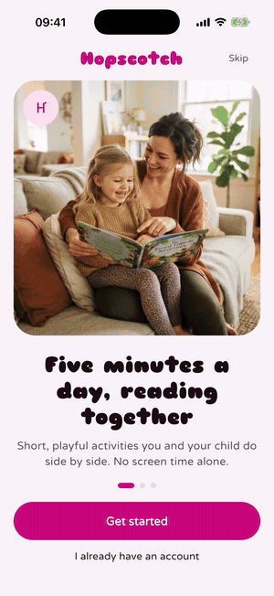 | 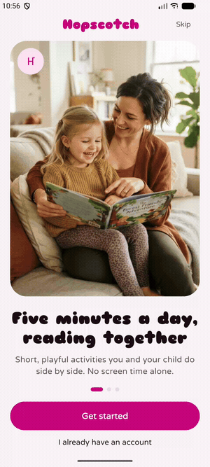 |

Same codebase running on both platforms.

## Screenshots

| Welcome | Child setup | Today | Tap the words |
|---|---|---|---|
| 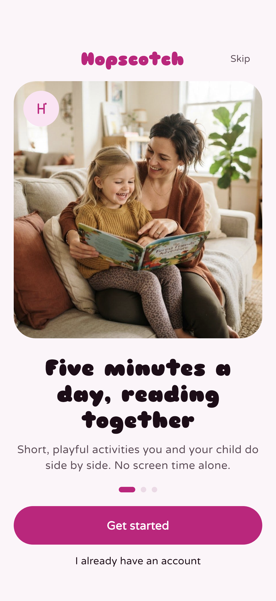 | 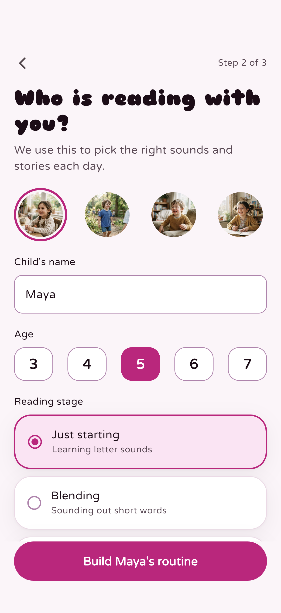 | 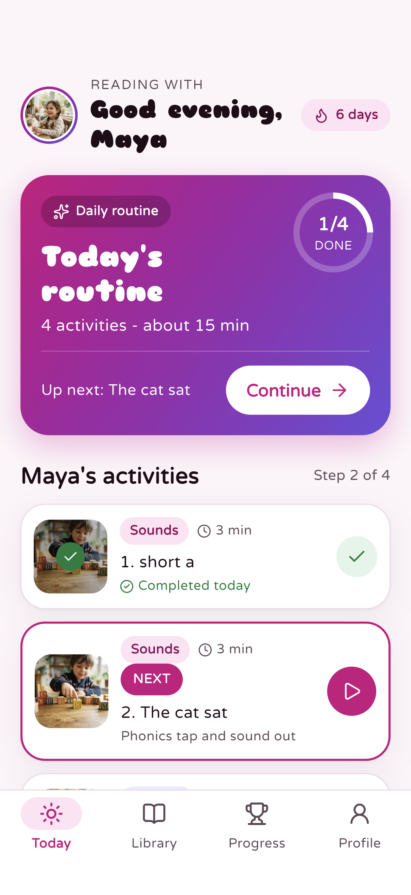 | 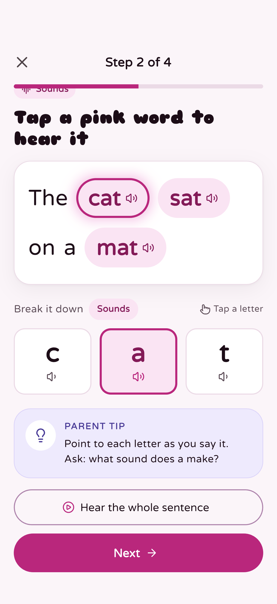 |

| Activity complete | Read along | Storybook | All done |
|---|---|---|---|
| 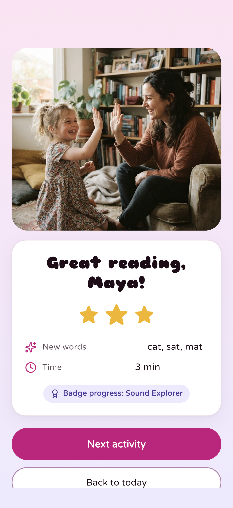 | 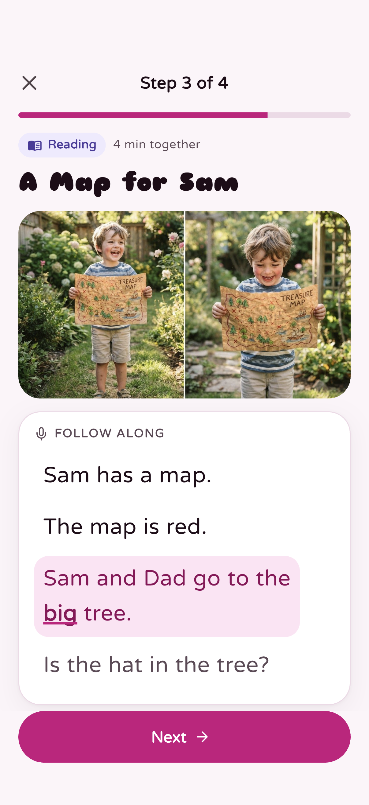 | 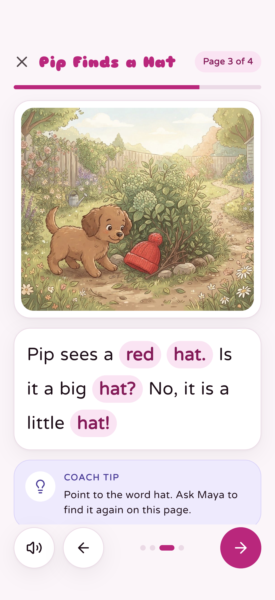 | 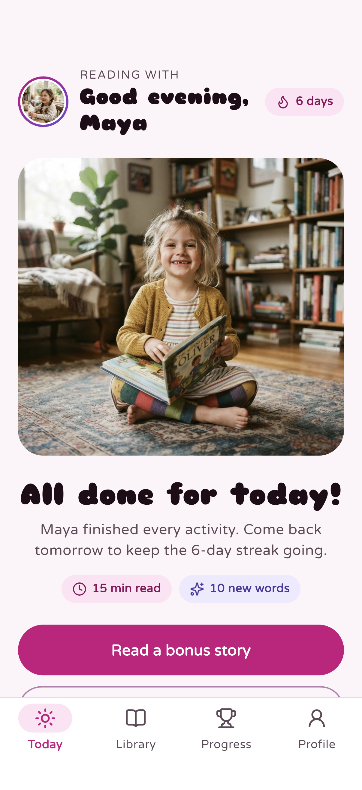 |

| Progress | Achievements | Library | Filters |
|---|---|---|---|
| 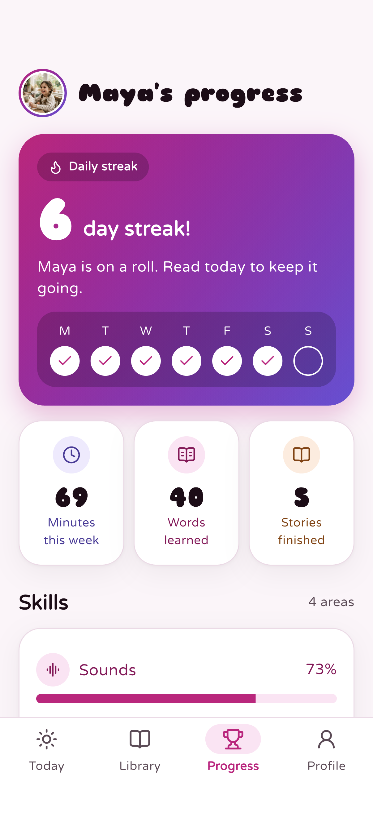 | 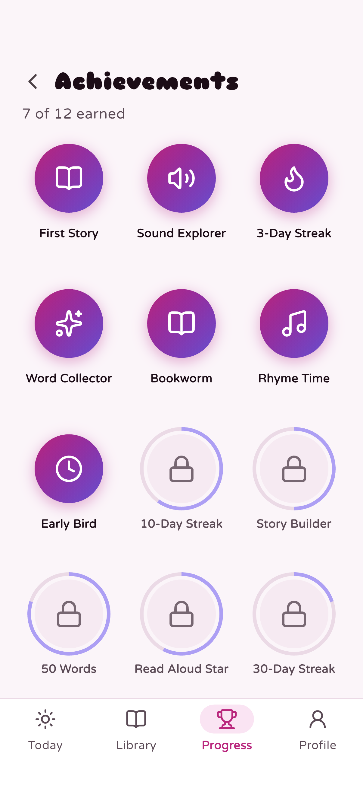 | 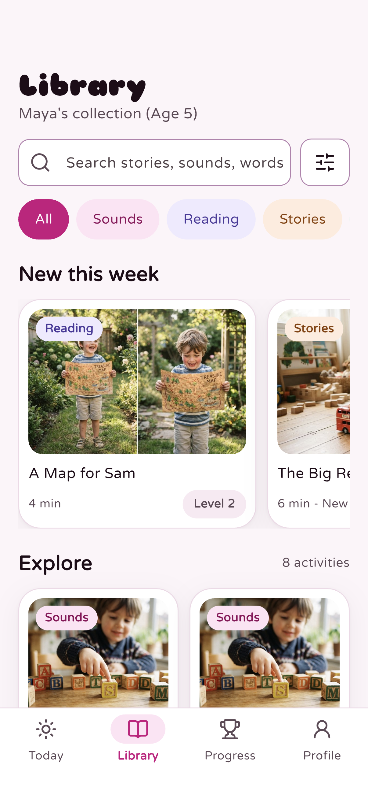 | 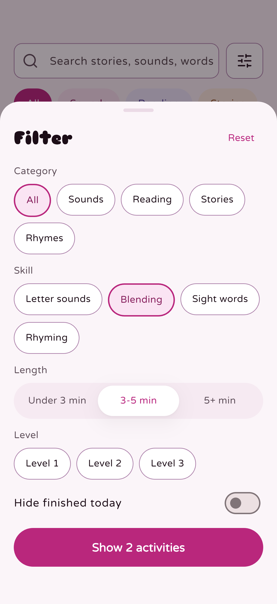 |

| Story detail | Parent gate | Parent area |
|---|---|---|
| 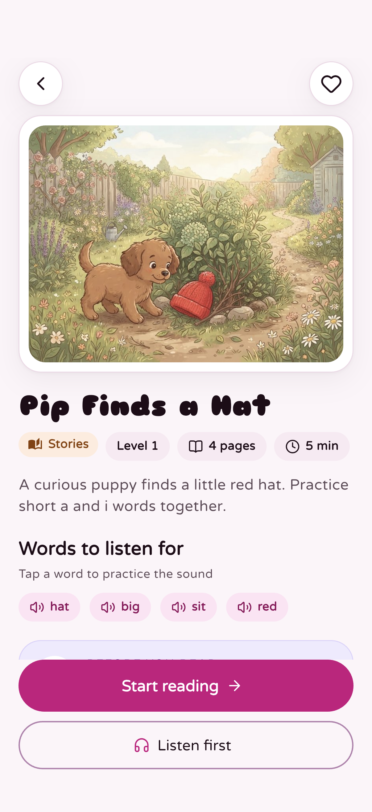 | 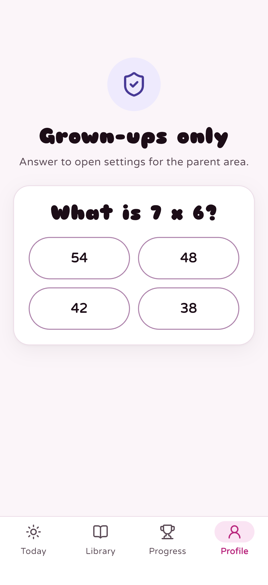 | 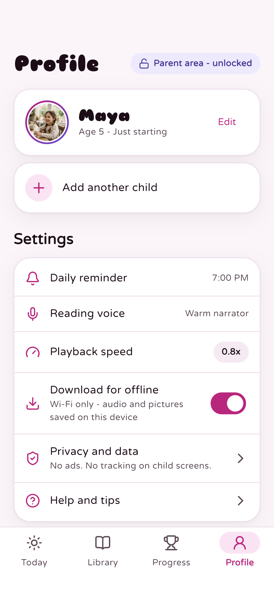 |

## What it shows

- **Personalized daily homepage** - today's routine is picked from the catalog by the child's reading stage (just starting, blending, reading), with a progress ring and an "Up next" shortcut.
- **Tap-a-word audio** - highlighted words play their recording; the word then breaks into letter tiles, and each tile plays its individual sound.
- **Audio-paired reading** - one narration file per passage plus per-word timestamps drive a karaoke-style highlight. Playback pauses at authored checkpoints so the parent can ask a question. Speed control (0.8x, 1x, 1.2x).
- **Illustrated storybook** - paginated, swipeable pages with read-aloud narration, highlighted target words and a coaching tip per page.
- **Progress dashboard** - day streak with a week view, minutes, words learned, stories finished, per-category skill bars and the next milestone.
- **Achievements** - 12 milestones computed from the session log, with progress rings on locked badges.
- **Content library** - search, category tabs and a filter sheet (category, skill, length, level, hide finished).
- **Parent area behind a parent gate** - child profile, reminders, reading voice, playback speed, offline download and privacy settings. No ads and no tracking on child screens.

## Flow

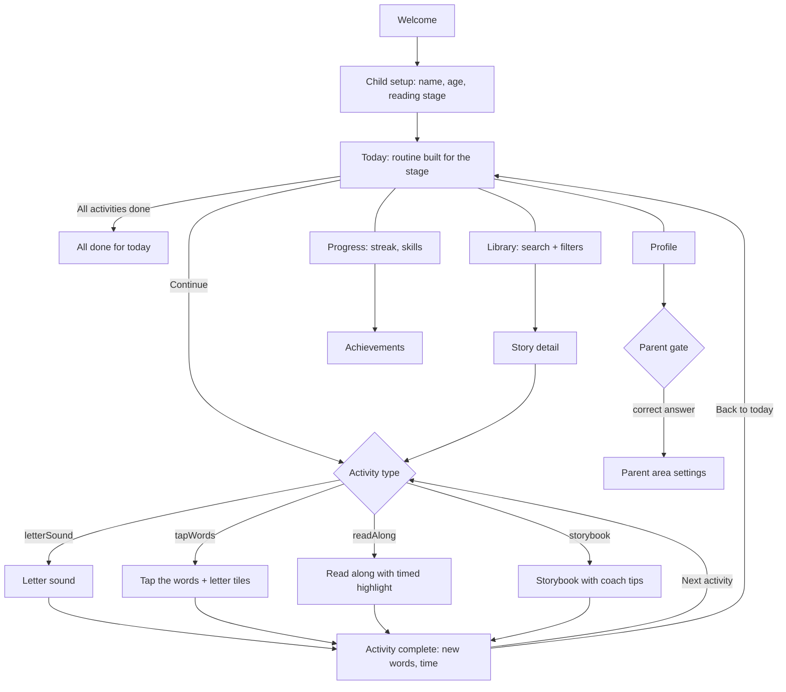

## Architecture

```
lib/
  app/            router (go_router, StatefulShellRoute tabs), shell, app
  core/theme/     design tokens: colors, category styles, type scale, radii
  data/
    models/       Activity + typed payloads (letterSound, tapWords, readAlong, storybook), progress
    repositories/ ContentRepository (bundled JSON) + Firestore implementation of the same interface
    seed.dart     demo child and five days of session history
  domain/         ProgressStats (streak, week, skills, achievements), RoutineBuilder - pure Dart, unit tested
  audio/          AudioService over just_audio: tap player for words/phonemes, passage player with position stream
  state/          Riverpod providers: catalog, child, progress, routine, library filter, parent gate
  features/       onboarding, today, activities, progress, library, profile
assets/
  content/catalog.json   structured lessons, routines and achievement rules
  audio/                 words, phonemes, sentences, passages, story pages (AAC)
tool/build_content.py    content pipeline: narration -> clips + word timestamps -> catalog.json
```

- **Content-driven rendering.** `Activity.fromJson` maps each catalog entry to a typed payload; `ActivityHost` picks the screen by payload type. Adding a story or a sound lesson only adds JSON and media.
- **Firestore-ready.** `catalog.json` mirrors the Firestore layout (`activities/`, `routines/`, `achievements/`) and `FirestoreContentRepository` reuses the same parser. Switching is a single provider override; media paths move to Cloud Storage.
- **Audio design.** Reading passages ship as one file with word timestamps instead of hundreds of tiny clips, which keeps taps responsive on Android and makes content upload simple. Short taps use a dedicated player so a new tap cuts the previous sound instantly.
- **Deterministic clock.** "Today", streaks and the greeting come from an injectable clock provider, which keeps tests and captures stable.

## Run

```sh
flutter pub get
flutter run            # iOS simulator or Android emulator
flutter test           # unit tests for streaks and read-along timing
```

Regenerate the content catalog and audio (macOS):

```sh
python3 tool/build_content.py
```
